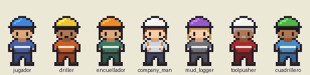

# Personajes y NPCs

Quiénes trabajan en el taladro, cómo hablan, qué le dicen al jugador en cada situación y cómo se ven. Los roles salen de `simulation-logic.md` §5; los avisos y eventos, de §4, §9, §10 y §14. **Todos los personajes son ficticios.**

## Regla de diseño

Ningún NPC identifica un contaminante químico a partir de síntomas (invariante 1). Pueden contar **lo que ven** ("el lodo corre más pesado", "huele a huevo podrido en la zaranda", "salen lajas grandes") o **lo que saben de la operación** ("vamos a rotar el tapón de cemento"), pero no diagnostican por el jugador. `tests/test_personajes.gd` busca en todos los diálogos las palabras cemento, yeso, anhidrita, carbonato, bicarbonato, calcio, magnesio, carnalita, H₂S, sulfhídrico, y sal y cal como palabra suelta. La única excepción es `cemento_por_perforar`, que es información de operación.

Tampoco le resuelven las cuentas: el driller entrega la presión de cierre y el peso de matada que pide el company man, pero le dice al jugador que lo confirme con su cálculo (`simulation-logic.md` §14).

## Personajes

| id | Nombre | Rol | Estación |
|---|---|---|---|
| `jugador` | Alex Rivas | Ingeniero/a de fluidos | `caseta_lodos` |
| `driller` | Ramón "Moncho" Quintero | Perforador | `piso_perforacion` |
| `encuellador` | Yesenia Barrios | Encuelladora | `tanques` |
| `company_man` | Patricia Salcedo | Company man (operadora) | `oficina` |
| `mud_logger` | Lucía Ferreyra | Mud logger | `cabina_mud_logger` |
| `toolpusher` | Aurelio Mamani | Toolpusher (jefe de taladro) | `bodega` |
| `cuadrillero` | Kevin Ortiz | Cuadrillero de zarandas | `zarandas` |

### Jugador — Alex Rivas

Ingeniero o ingeniera de fluidos recién llegado al taladro. El diseño base es neutral: nombre unisex, pelo corto bajo el casco, overol azul. Más adelante puede ser personalizable (nombre, piel, pelo) cambiando la paleta en `tools/generar_personajes.py`. Sus líneas son pensamientos entre paréntesis que recuerdan el método: medir, diagnosticar, tratar.

**Sprite:** casco azul, overol azul con cinta reflectiva, piel media.

### Driller — Ramón "Moncho" Quintero

Veinte años en taladros. Directo, de pocas palabras, cuida su pozo. Opera el taladro desde la consola y al inicio del turno informa profundidad y formación. **Hay que avisarle antes de transferir**: si no, salta la alarma del PVT, para la mesa y se queja explicando el porqué (§4). Ante un kick cierra el pozo y entrega la presión de cierre; el control del pozo es suyo, el lodo de matada es del jugador.

**Habla:** trata de "usted", dice "inge", "darle al hueco", "parar la mesa", "el pozo está tomando".

**Aporta:** información de operación (profundidad, formación, cemento por rotar), eventos (kick, pérdida) y presión por el tiempo de taladro.

**Sprite:** casco amarillo, overol naranja, piel morena, bigote.

### Encuelladora — Yesenia Barrios

Trabaja en la torre durante los viajes y el resto del tiempo cuida los tanques. Rápida y ordenada. Por orden del jugador **ejecuta las mezclas largas** en el embudo a 50 sacos/h (§5, §8) y avisa cuando termina; el resultado lo verifica el jugador. Ve primero lo que pasa en los tanques: nivel que baja, lodo que se pone espeso, recortes raros. Lo cuenta tal cual y deja el diagnóstico al ingeniero.

**Habla:** trata de "usted" al ingeniero, "el activo", "la canaleta", "los agitadores".

**Aporta:** ayuda (tiempo del turno), alarma temprana por observación.

**Sprite:** casco naranja, overol verde, piel media, pelo largo oscuro.

### Company man — Patricia Salcedo

Representante de la operadora. Formal, exigente, con el programa siempre en la mano. Recibe el reporte diario y **pide explicaciones** cuando algo sale de especificación o el costo pasa el presupuesto (§9). No le alcanza con "ya lo arreglo": quiere saber qué prueba mostró la causa. Ante gas en las conexiones pide subir la densidad (§10.2).

**Habla:** "ingeniero", registro formal, frases cortas.

**Aporta:** presión (programa, costo, reporte), órdenes de densificar.

**Sprite:** casco blanco (supervisión), camisa celeste con chaleco naranja, pantalón oscuro, piel clara, pelo largo castaño.

### Mud logger — Lucía Ferreyra

Geóloga de mud logging, argentina. Curiosa y conversadora. Vigila gas de fondo, gas de conexión y recortes, y avisa al driller y al company man (§10.2). Es otra fuente de alarma, distinta del ingeniero de lodos.

**Habla:** voseo ("pasá", "mirá", "vos"), "cromatógrafo", "pico de gas".

**Aporta:** alarma por gas y por cambios en el recorte.

**Sprite:** casco violeta, overol gris, piel clara, pelo largo rubio.

### Toolpusher — Aurelio Mamani

Jefe del taladro en sitio, responsable de todas las cuadrillas y de la logística; por eso se lo encuentra cerca de la bodega. Veterano y paciente. Es el mentor: da **consejos de oficio** que refuerzan las trampas pedagógicas (avisar antes de transferir, la observación no diagnostica, prueba piloto, barita en reserva, asentamiento en lodos pesados).

**Habla:** "ingeniero", refranes de taladro.

**Aporta:** consejos. En la situación `consejo` cada página es un consejo suelto: la interfaz puede mostrar uno al azar o en orden.

**Sprite:** casco blanco, overol rojo oscuro, piel morena, pelo y bigote canosos.

### Cuadrillero — Kevin Ortiz

Ayudante nuevo, con **casco verde**: en muchos taladros el casco verde marca al novato. Entusiasta y preguntón. Cuida las zarandas y cuenta con detalle lo que sale por ellas: lajas, astillas, rebose, olor. Nunca saca conclusiones.

**Habla:** "¡qué más, inge!", "le cuento lo que veo".

**Aporta:** alarma por observación en zarandas.

**Sprite:** casco verde, overol celeste, piel morena, pelo corto.

## Estaciones

Ids que usa `estacion` (lista en `sim/personaje.gd`, `ESTACIONES`):

| id | Lugar |
|---|---|
| `piso_perforacion` | Piso de perforación y consola del driller |
| `tanques` | Tanques del sistema activo y de reserva |
| `oficina` | Oficina del company man |
| `cabina_mud_logger` | Cabina del mud logger |
| `caseta_lodos` | Caseta de lodos (laboratorio) |
| `zarandas` | Zarandas y control de sólidos |
| `bodega` | Bodega de químicos |

## Situaciones de diálogo

| Situación | Quién | Cuándo |
|---|---|---|
| `saludo` | todos | Por defecto; `lineas()` cae acá si la situación no existe |
| `inicio_turno` | driller, jugador | Inicio del turno. Variables `{profundidad}`, `{formacion}` |
| `aviso_transferencia` | driller | El jugador avisa antes de transferir |
| `falsa_alarma_pvt` | driller | Transfirió sin avisar: explica por qué el PVT salta |
| `kick` | driller | Ganancia en tanques. Variables `{sidpp}`, `{peso_matada}` |
| `perdida` | driller, encuelladora, cuadrillero | El nivel baja o llega menos lodo |
| `cemento_por_perforar` | driller | Van a rotar el tapón de cemento (información de operación) |
| `orden_mezcla` / `mezcla_terminada` | encuelladora | Mezcla larga en el embudo |
| `lodo_espeso` | encuelladora | Ve el lodo más espeso, sin decir por qué |
| `recortes_raros` | encuelladora, mud logger, cuadrillero | Derrumbes, sin diagnosticar |
| `rebose_zarandas` | cuadrillero | La zaranda bota lodo |
| `olor_raro` | cuadrillero | Olor a huevo podrido; se retira y avisa |
| `gas_conexion` / `gas_fondo_sube` | mud logger | Gas (§10.2) |
| `fuera_de_especificacion` / `costo_alto` / `reporte_recibido` | company man | Reporte y programa (§9) |
| `pedido_densificar` | company man | Pide subir densidad por gas |
| `consejo` | toolpusher | Consejos de oficio |

**Formato.** Cada página cabe en la caja de diálogo a 240×160 px: **2 líneas de 32 caracteres**, partidas por palabras (`Personaje.partir_en_lineas`). La prueba mide el largo con valores de ejemplo en las variables (profundidad "12.345", formación "lutita de Carbonera"). Una variable que falta en el contexto queda escrita tal cual (`{sidpp}`), para que se note.

## Sprites

Hojas en `assets/personajes/<id>.png`, generadas con `python3 tools/generar_personajes.py` (reproducible, sin azar):

- Hoja de **48×128 px**: 3 columnas × 4 filas, cuadro de **16×32 px**, fondo transparente.
- Columnas: quieto, paso A, paso B. Filas: abajo, izquierda, derecha (espejo de izquierda), arriba.
- Estilo inspirado en los juegos de GBA, **dibujado desde cero**: contorno oscuro, cabeza grande, casco con brillo, cinta reflectiva en el torso. Cada píxel sale de plantillas de texto del script y de una paleta por personaje (casco, ropa, pantalón, piel, pelo, pelo largo, bigote, chaleco).
- Vista previa: `docs/img/personajes.png` (los siete mirando abajo, ×4).

Colores de casco por rol: blanco para supervisión (company man, toolpusher), verde para el novato, y un color distinto para cada uno del resto, para reconocerlos de lejos en el mapa.
